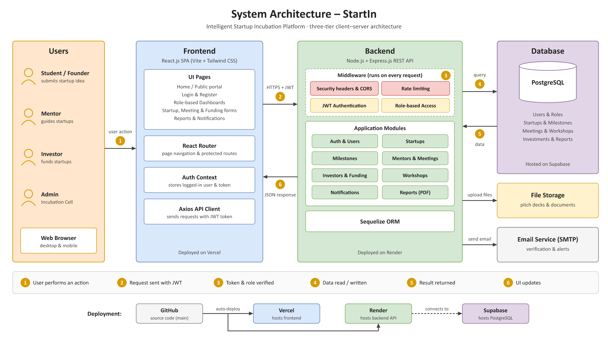
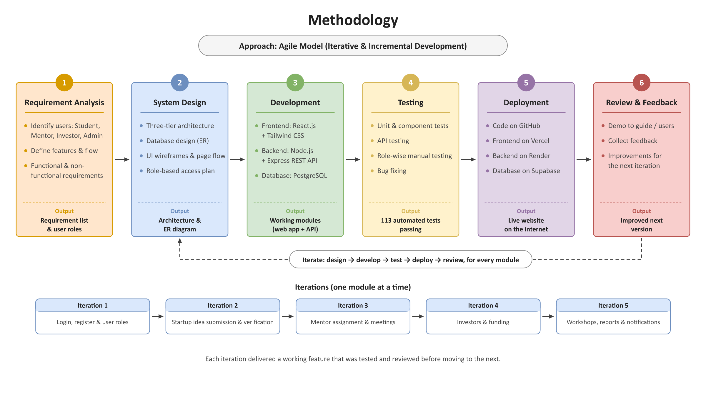

<div align="center">

# StartIn — Intelligent Startup Incubation Platform (ISIP)

**One portal for the whole campus startup journey: idea → verification → mentoring → milestones → investor funding → incubation.**

[](https://isip-theta.vercel.app)
[](https://startin-api.onrender.com/api/health)


</div>

---

## Table of contents

1. [Overview](#overview)
2. [Live demo](#live-demo)
3. [User roles](#user-roles)
4. [Features](#features)
5. [The incubation rule](#the-incubation-rule)
6. [System architecture](#system-architecture)
7. [Methodology](#methodology)
8. [Tech stack](#tech-stack)
9. [Project structure](#project-structure)
10. [Database](#database)
11. [API reference](#api-reference)
12. [Getting started (local)](#getting-started-local)
13. [Environment variables](#environment-variables)
14. [Scripts](#scripts)
15. [Testing](#testing)
16. [Security & non-functional requirements](#security--non-functional-requirements)
17. [Portal design](#portal-design)
18. [Use cases → screens](#use-cases--screens)
19. [Deployment](#deployment)
20. [Troubleshooting](#troubleshooting)
21. [Future scope](#future-scope)

---

## Overview

Campus incubation cells usually run on Google Forms, email threads and spreadsheets. Founders don't know where their
application stands, mentors lose track of meetings, and investors have no single place to discover student startups.

**StartIn** replaces all of that with one web platform:

- **Student founders** register their startup idea, track milestones, meet mentors, upload pitch decks and receive
  investment offers.
- **Mentors** accept assigned startups, review milestone updates, give feedback and run meetings.
- **Investors** browse verified startups, make offers and request meetings.
- **The Incubation Cell (admin)** verifies startups, assigns mentors, clears funding transactions, runs workshops and
  generates reports.

Everything — status, progress, meetings, documents, funding and notifications — is visible in role-based dashboards.

---

## Live demo

| | URL |
|---|---|
| Web app | **https://isip-theta.vercel.app** |
| API health check | https://startin-api.onrender.com/api/health |

> **First load can take ~1 minute.** The API runs on Render's free plan and sleeps after 15 minutes without traffic.
> The web app shows a "waking up" state and retries automatically — it does not log you out.

**Accounts on the live site:** the administrator account is the one configured in Render (`ADMIN_EMAIL` /
`ADMIN_PASSWORD`). The demo accounts listed in [Demo accounts](#demo-accounts-local-development) also exist on the
live site, but there they all use the private `DEMO_PASSWORD` set in Render — it is intentionally **not** published
here. Ask the project team for it.

---

## User roles

| Role | What they do |
|---|---|
| **Student / Founder** | Creates and submits startups, manages team members, submits milestone updates, uploads documents, requests mentor meetings, pitches to investors, accepts/declines offers, registers for workshops |
| **Mentor** | Accepts assigned startups, reviews milestone updates (approve / return), adds custom milestones, gives feedback, schedules and runs meetings |
| **Investor** | Browses approved & incubated startups, views read-only profiles, makes investment offers, requests meetings, tracks a portfolio |
| **Admin (Incubation Cell)** | Verifies startups (approve / reject with remarks), assigns mentors, clears / holds / cancels funding transactions, manages users, workshops and announcements, generates reports, reads the audit log |

---

## Features

| # | Module | What's implemented |
|---|---|---|
| 1 | **User Authentication** | Register (Student / Mentor / Investor), email verification, login, logout, forgot / reset password, change password, JWT sessions, role-based access, return to the original page after login |
| 2 | **Startup Registration** | Create / edit / delete startups with name, industry, description, team members, tech stack, problem, solution and business model. Lifecycle: Draft → **Pending → Approved → Incubated** (or Rejected with remarks and resubmit). A startup becomes **Incubated only once it secures finance** |
| 3 | **Mentor Management** | Admin assigns / removes mentors; mentors **accept** assignments (with a banner on the startup page); mentor dashboard shows assigned startups, meetings, pending reviews and completed milestones |
| 4 | **Milestone Tracking** | Approval auto-creates Idea Validation → Prototype → MVP → Customer Testing → Revenue → Funding. Students submit updates, mentors approve or return them, and the **progress bar recalculates automatically**. Mentors can add custom milestones |
| 5 | **Funding Transactions** | Funding happens **only between founders and investors**. When a founder accepts an investor offer it becomes a transaction; the admin can only **clear** it, put it **on hold** (with a reason) or **cancel** it (with a reason). Only cleared deals count as finance. Admin **Transactions** page with filters |
| 6 | **Meeting Scheduler** | Students request meetings with assigned mentors; mentors **accept / reject / reschedule** or **schedule directly**. Venue or video link per meeting. **Automatic lifecycle:** check-in opens 15 min before start; unconfirmed requests **expire** and confirmed meetings nobody checks in to are marked **missed** 10 min after start; checked-in meetings auto-complete after an hour. Same rules for investor meetings |
| 7 | **Document Repository** | Upload PDF, PPT/PPTX, DOC/DOCX, XLS/XLSX, images and text (pitch decks, business plans, prototype images). Re-uploading under the same title creates a new **version** with full history |
| 8 | **Workshop Management** | Admin creates workshops, hackathons and training sessions with capacity; students register; admin marks attendance; **PDF certificates** for attendees |
| 9 | **Notifications** | Bell icon (live count), notifications page and email for milestone reviews, meetings, offers, clearances, workshops and assignments; admin announcements |
| 10 | **Reports** | Startup count, finance cleared vs awaiting clearance, active mentors, industry-wise startups, monthly registrations, workshop stats. Charts (Chart.js), saved reports, **PDF export** (PDFKit) and **CSV export** |
| 11 | **Investor Module** | Investors register (Angel / VC / Corporate …), browse startups, view pitch documents, **make offers** (amount, equity %, instrument) and **request meetings** (intro, due diligence, follow-up). Founders browse an **Investors directory** and send pitch requests. Investor dashboard with focus-industry recommendations |
| 12 | **People profiles** | Click any name to open a profile: headline, bio, skills, links, plus an activity report (startups, mentorships, portfolio, certificates) and automatically earned achievements. Private data is shown only to the owner and admins |
| 13 | **Public portal** | Home page with live statistics, programmes, the six-step journey, events, a showcase of incubated startups, FAQs and an animated intro |
| 14 | **Search** | Live search on the startups and users lists |

**Dashboards:** separate Student, Mentor, Investor and Admin dashboards, each with charts and "what needs my attention" lists.

---

## The incubation rule

A startup is incubated **only when it gets finance**.

```
Draft → Pending → Approved ──(secures finance)──► Incubated
```

*Finance* means an **investor deal that the founder accepted and the admin cleared**. The platform never grants money itself.

```
Investor offer ──(founder accepts)──► Under review ──(admin clears)──► Cleared = finance
                                          │  ▲
                              (admin holds)  │ (admin clears)
                                          ▼  │
                                        On hold ──(admin cancels)──► Cancelled
```

- Clearing a transaction moves an approved startup to **Incubated automatically** and notifies founder, investor, mentors and admins.
- Holding or cancelling needs a reason, which both the founder and the investor see. Cleared and cancelled transactions are final.
- The admin's manual "Mark as incubated" button stays disabled — and the API refuses the change — until the startup has finance.
- Approved startups show an "Awaiting finance" banner; the admin dashboard lists every startup still waiting.

---

## System architecture



StartIn is a **three-tier client–server application**:

| Tier | Technology | Hosted on |
|---|---|---|
| Presentation | React 19 single-page app (Vite, Tailwind CSS, React Router) | Vercel |
| Application | Node.js + Express 5 REST API | Render |
| Data | PostgreSQL via Sequelize ORM (SQLite locally) | Supabase |

**How one request flows**

1. The user acts in the browser (e.g. submits a milestone update).
2. The React app's Axios client sends an HTTPS request to `/api/...` with the user's **JWT** in the `Authorization` header.
3. Express middleware runs on every request: security headers (Helmet) → CORS → rate limiting (auth routes) → **JWT authentication** → **role-based access** → audit logging (→ Multer for uploads).
4. The route module applies the business rules and reads / writes data through **Sequelize**.
5. PostgreSQL returns the data; side effects run (notification, email, PDF).
6. The API answers with JSON and the UI updates.

---

## Methodology



The project followed an **Agile (iterative & incremental)** approach: requirement analysis → system design →
development → testing → deployment → review, repeated module by module (authentication → startups → mentoring →
investors & funding → workshops, reports & notifications). Every iteration produced a working, tested feature.

---

## Tech stack

**Frontend (`client/`)**

| Purpose | Technology |
|---|---|
| UI library | React 19 |
| Build tool / dev server | Vite 8 |
| Styling | Tailwind CSS v4 |
| Routing | React Router 7 |
| HTTP client | Axios (JWT interceptor, wake-up retries) |
| Charts | Chart.js + react-chartjs-2 |
| Icons | Lucide React |
| Toasts | React Hot Toast |
| Intro animation | HTML5 Canvas (`public/intro.html`, plain JavaScript) |

**Backend (`server/`)**

| Purpose | Technology |
|---|---|
| Runtime | Node.js 22 |
| Framework | Express 5 |
| ORM | Sequelize 6 (`pg` for PostgreSQL, `sqlite3` locally) |
| Authentication | jsonwebtoken (JWT), bcryptjs |
| Field encryption | Node `crypto` — AES-256-GCM |
| File uploads | Multer |
| Email | Nodemailer (SMTP) |
| PDF generation | PDFKit |
| Security | Helmet, CORS, express-rate-limit |
| Logging | Morgan + custom audit logger |
| Config | dotenv |

**Testing & tooling:** Vitest, React Testing Library, jsdom, Node test runner, Supertest, Oxlint, concurrently.

**Hosting:** GitHub → Vercel (frontend) · Render (API) · Supabase (PostgreSQL).

---

## Project structure

```
ISIP/
├── client/                      React app (Vite)
│   ├── public/
│   │   ├── intro.html           Animated intro (canvas), played once per session; replay button in the header
│   │   ├── logo.svg             StartIn logo (+ favicon / touch-icon PNGs)
│   ├── src/
│   │   ├── pages/               auth, dashboards, startups (+ tabs), meetings, funding, workshops,
│   │   │                        notifications, profile, people profiles, investor/*, admin/*
│   │   ├── components/          Layout, portal chrome (header, footer, intro), UI kit, panels
│   │   ├── context/             AuthContext (session, wake-up retry)
│   │   ├── api/ · utils/        Axios client, helpers (redirects, events, formatting)
│   │   └── *.test.jsx           Frontend tests next to the code
│   ├── vercel.json              SPA rewrites
│   └── .env.example
├── server/                      Express API
│   ├── src/
│   │   ├── app.js               Middleware pipeline + route mounting
│   │   ├── server.js            Start-up (DB sync, admin/demo bootstrap)
│   │   ├── config/db.js         Sequelize connection (PostgreSQL or SQLite)
│   │   ├── models/index.js      All 20 tables + associations
│   │   ├── routes/              15 route modules (see API reference)
│   │   ├── middleware/          auth (JWT + RBAC), audit logger, upload
│   │   ├── services/            access control & incubation rule, notify, mailer,
│   │   │                        meeting lifecycle, stats, report PDF
│   │   ├── utils/               crypto (AES-256-GCM), http helpers
│   │   ├── seed.js              Demo data
│   │   ├── backup.js            JSON backup of every table
│   │   └── timezone.js          Pins the app time zone (APP_TIMEZONE)
│   ├── tests/api.test.js        API integration tests
│   └── .env.example
├── docs/                        Architecture & methodology diagrams
├── render.yaml                  Render blueprint for the API
└── package.json                 Root scripts (dev, test, build, seed, backup)
```

---

## Database

**20 tables:** `Roles`, `Users`, `Startups`, `StartupMembers`, `Mentors`, `MentorAssignments`, `Milestones`,
`MilestoneUpdates`, `MeetingRequests`, `Meetings`, `Documents`, `Workshops`, `WorkshopRegistrations`,
`Notifications`, `Feedback`, `Reports`, `AuditLogs`, `Investors`, `InvestmentInterests`, `InvestorMeetings`.

Key relationships:

- User **creates** Startup (1 : \*); Startup **has** Members, Milestones and Documents (1 : \*)
- Milestone **has** MilestoneUpdates (1 : \*)
- Mentor ↔ Startup through **MentorAssignment** (M : N)
- MeetingRequest **results in** Meeting (1 : 0..1)
- Workshop **has** WorkshopRegistrations (1 : \*)
- Mentor **provides** Feedback; Investor **makes** InvestmentInterests and InvestorMeetings

Locally the database is a SQLite file (`server/data/isip.sqlite`) created on first start; in production it is
PostgreSQL on Supabase. Phone numbers are encrypted at rest.

---

## API reference

Base URL: `/api` (e.g. `https://startin-api.onrender.com/api`). All routes except `public`, `health` and the
sign-up / login flow need `Authorization: Bearer <JWT>`; role checks are enforced per route.

| Module | Endpoints |
|---|---|
| Health | `GET /health` |
| Public | `GET /public/overview` — aggregate stats for the home page (no personal data, cached 60 s) |
| Auth | `POST /auth/register` · `POST /auth/verify-email` · `POST /auth/resend-verification` · `POST /auth/login` · `POST /auth/logout` · `POST /auth/forgot-password` · `POST /auth/reset-password` · `GET /auth/me` · `PUT /auth/profile` · `PUT /auth/password` |
| Startups | `GET /startups` · `POST /startups` · `GET /startups/:id` · `PUT /startups/:id` · `DELETE /startups/:id` · `POST /startups/:id/submit` · `PATCH /startups/:id/status` · `POST /startups/:id/members` · `PUT /startups/:id/members/:memberId` · `DELETE /startups/:id/members/:memberId` |
| Milestones | `GET /milestones` · `POST /milestones` · `PUT /milestones/:id` · `DELETE /milestones/:id` · `POST /milestones/:id/updates` · `POST /milestones/updates/:updateId/review` · `POST /milestones/:id/complete` |
| Mentors | `GET /mentors` · `GET /mentors/me` · `GET /mentors/assignments` · `POST /mentors/assignments` · `PATCH /mentors/assignments/:id/accept` · `DELETE /mentors/assignments/:id` |
| Meetings | `GET /meetings/requests` · `POST /meetings/requests` · `PATCH /meetings/requests/:id` · `GET /meetings` · `POST /meetings` · `PATCH /meetings/:id` |
| Feedback | `GET /feedback` · `POST /feedback` · `PUT /feedback/:id` |
| Documents | `GET /documents` · `POST /documents` (multipart) · `GET /documents/:id/download` · `DELETE /documents/:id` |
| Workshops | `GET /workshops` · `POST /workshops` · `PUT /workshops/:id` · `PATCH /workshops/:id/cancel` · `POST /workshops/:id/register` · `DELETE /workshops/:id/register` · `GET /workshops/:id/registrations` · `PATCH /workshops/registrations/:rid/attendance` · `GET /workshops/registrations/:rid/certificate` |
| Investors | `GET /investors` · `GET /investors/directory` · `GET /investors/interests` · `POST /investors/interests` · `PATCH /investors/interests/:id/withdraw` · `PATCH /investors/interests/:id/respond` · `PATCH /investors/interests/:id/clearance` · `GET /investors/meetings` · `POST /investors/meetings` · `PATCH /investors/meetings/:id` |
| Notifications | `GET /notifications` · `PATCH /notifications/read-all` · `PATCH /notifications/:id/read` · `POST /notifications/announce` |
| Users (admin) | `GET /users` · `POST /users` · `PATCH /users/:id` |
| People | `GET /people/:id` |
| Dashboard | `GET /dashboard` — role-specific dashboard data |
| Reports | `GET /reports/summary` · `GET /reports/types` · `GET /reports` · `POST /reports/generate` · `GET /reports/:id` · `GET /reports/:id/csv` · `GET /reports/:id/pdf` · `GET /reports/audit/logs` |

---

## Getting started (local)

**Requirements:** Node.js 20+ and npm. No database install is needed — SQLite is used locally.

```bash
git clone https://github.com/PANTH2517/ISIP.git
cd ISIP
npm run install:all                  # installs root, server and client dependencies
cp server/.env.example server/.env   # then set JWT_SECRET and ENCRYPTION_KEY to long random strings
npm run dev                          # API on http://localhost:5000, web app on http://localhost:5173
```

On first start the server creates `server/data/isip.sqlite` and loads demo data. In development, Vite proxies
`/api` to the local API, so `client/.env` is optional.

### Demo accounts (local development)

| Role | Email | Password |
|---|---|---|
| Admin (Incubation Cell) | `admin@isip.edu` | `Admin@123` |
| Mentor | `priya.mentor@isip.edu` (also `rahul.mentor@isip.edu`, `anita.mentor@isip.edu`) | `Password@123` |
| Student / Founder | `aarav.student@isip.edu` (also `riya.student@isip.edu`, `kabir.student@isip.edu`, `meera.student@isip.edu`) | `Password@123` |
| Investor | `vikram.investor@isip.edu` (also `neha.investor@isip.edu`) | `Password@123` |

The login page has one-click buttons that fill these in during development. These well-known passwords exist **only
locally** — in production every demo account uses `DEMO_PASSWORD` instead.

**Emails locally:** if `SMTP_HOST` is empty, emails (verification, reset, notifications) are printed to the server
console, and the verification / reset link is shown in the UI in development mode.

---

## Environment variables

**Server (`server/.env`)**

| Variable | Required | Description |
|---|---|---|
| `PORT` | – | API port (default `5000`) |
| `NODE_ENV` | – | `development` or `production` |
| `APP_TIMEZONE` | – | Time zone for meeting times, check-in windows and report dates (default `Asia/Kolkata`) |
| `CLIENT_URL` | prod | Web app address(es), comma-separated — used for CORS and email links |
| `JWT_SECRET` | **prod** | Secret for signing tokens; the server refuses to start in production without it |
| `JWT_EXPIRES_IN` | – | Token lifetime (default `7d`) |
| `ENCRYPTION_KEY` | **prod** | Key for AES-256-GCM field encryption; required in production |
| `DATABASE_URL` | prod | PostgreSQL connection string; leave empty for local SQLite |
| `DB_SSL` | – | Use SSL for PostgreSQL (default `true`) |
| `UPLOAD_DIR` / `MAX_UPLOAD_MB` | – | Upload folder (default `uploads`) and size limit (default `10`) |
| `ADMIN_EMAIL` / `ADMIN_PASSWORD` | prod | Administrator account created on start if missing |
| `SEED_DEMO` / `DEMO_PASSWORD` | – | Load demo data into an empty production database; all demo accounts use `DEMO_PASSWORD` |
| `SMTP_HOST`, `SMTP_PORT`, `SMTP_USER`, `SMTP_PASS`, `MAIL_FROM` | – | Real email. Without SMTP in production, new accounts are auto-verified and reset links are only logged |

**Client (`client/.env`)**

| Variable | Description |
|---|---|
| `VITE_API_URL` | API base URL in production, e.g. `https://startin-api.onrender.com` (`/api` is appended if missing). Leave empty locally |
| `VITE_INSTITUTE_NAME` | Institute name shown in the header and footer |
| `VITE_HELPDESK_EMAIL` | Help-desk email shown in the footer |

---

## Scripts

Run from the repository root:

| Command | What it does |
|---|---|
| `npm run install:all` | Install root, server and client dependencies |
| `npm run dev` | Run API + web app together (concurrently) |
| `npm run seed` | Wipe the local database and reload demo data |
| `npm test` | Run all tests (server, then client) |
| `npm run test:server` / `npm run test:client` | Run one side only |
| `npm run backup` | Export every table to `server/backups/isip-backup-<timestamp>.json` |
| `npm run build` | Production build of the React app (`client/dist`) |
| `npm start` | Start the API (also serves `client/dist` if present) |

In `client/`: `npm run lint` runs Oxlint.

---

## Testing

| Suite | Tools | Tests |
|---|---|---|
| Frontend (`client/src/**/*.test.jsx`) | Vitest, React Testing Library, jsdom | 74 |
| API integration (`server/tests/api.test.js`) | Node test runner, Supertest | 39 |
| **Total** | | **113** |

The API tests run against an isolated SQLite database and cover authentication, role-based access, the startup
lifecycle, milestone reviews, meetings, the funding / incubation rule, workshops, documents and reports. Frontend
tests cover pages, routing guards, forms and shared components.

```bash
npm test
```

---

## Security & non-functional requirements

| Requirement | How it's met |
|---|---|
| Secure authentication | bcrypt password hashing, JWT sessions, rate-limited auth endpoints |
| Role-based access | `authorize()` middleware plus per-startup ownership / assignment checks (`services/access.js`) |
| Data encryption | Phone numbers encrypted at rest with AES-256-GCM (`utils/crypto.js`) |
| Secure headers & CORS | Helmet; CORS allows only the configured `CLIENT_URL` origins |
| Safe uploads | Extension allow-list and size limit (Multer) |
| Audit logging | Every state-changing request is logged; viewable at **Admin → Audit Log** |
| Secrets | Required in production (`JWT_SECRET`, `ENCRYPTION_KEY`); reset links are never exposed in production |
| Backup support | `npm run backup` exports all tables to JSON |
| Reliability | The web app keeps the session while the API wakes up; only a real `401` ends it |
| Responsive & accessible UI | Responsive layout, collapsible mobile sidebar, A- / A / A+ text size, skip link, breadcrumbs |
| Scalability | Stateless REST API, separate frontend and backend, PostgreSQL in production |

---

## Portal design

- Clean institutional **portal** style: navy and orange theme, slim masthead with the StartIn logo, navigation bar,
  breadcrumbs and an institutional footer. Not tied to any country — no flags or official emblems.
- **Logo:** a light bulb whose filament is a growing sapling — an idea nurtured into a venture.
- **Animated intro:** an ~18-second story drawn in code (HTML5 Canvas) — an idea becomes a seed, grows into a circuit
  tree, gathers founder, mentor, investor and incubation cell into one ecosystem, then climbs the six portal
  milestones before the StartIn name appears. It plays once per session on the home page; **Skip** / `Esc` closes it
  and the small ▷ button in the header replays it. Skipped for users who prefer reduced motion.
- **Branding:** set `VITE_INSTITUTE_NAME` and `VITE_HELPDESK_EMAIL` in `client/.env`.

---

## Use cases → screens

| Use case | Actor(s) | Screen |
|---|---|---|
| Register / Login | All | `/register`, `/login` |
| Manage startup profile · Submit startup idea | Student | My Startups → New / Edit / Submit |
| Manage documents | Student, Mentor, Investor (read-only), Admin | Startup → Documents tab |
| View / review startup | All / Mentor | Startup detail page |
| Manage meetings | Student, Mentor, Admin | Meetings |
| Track milestones | Student, Mentor, Admin | Startup → Milestones tab |
| Provide feedback | Mentor | Startup → Mentor feedback tab |
| Manage funding | Student, Investor, Admin | Investors tab (accept offers) · Transactions (clear / hold / cancel) |
| Manage workshops & events | Student, Admin | Workshops & Events |
| Manage users | Admin | Users |
| Assign mentors · Verify startup | Admin | Mentors; Startup → Approve / Reject / Assign mentor |
| Generate reports | Admin | Reports |
| Manage notifications | All | Bell icon, Notifications (admin: announcements) |
| Browse startups · Make offer · Request meeting | Investor | Browse Startups → startup page; My Offers; Meetings |
| Respond to investors | Student | Startup → Investors tab |

---

## Deployment

Database on **Supabase**, API on **Render** ([`render.yaml`](render.yaml)), frontend on **Vercel**. All three
have free plans, and Vercel and Render redeploy automatically on every push to `main`.

1. **Supabase** — create a project, then **Connect → Connection string → Session pooler** and copy it
   (`postgresql://postgres.<ref>:<password>@aws-0-<region>.pooler.supabase.com:5432/postgres`).
   Use the pooler: the *Direct connection* host is IPv6-only and Render can't reach it.
2. **Render** — **New → Blueprint**, connect this repository (branch `main`) and fill in:
   - `DATABASE_URL` — the Supabase Session pooler string
   - `ADMIN_EMAIL` / `ADMIN_PASSWORD` — your administrator login (8+ characters with a letter and a number)
   - `DEMO_PASSWORD` — password for all demo accounts (leave empty for an empty platform)
   - `CLIENT_URL` — placeholder for now; set it after step 3

   `JWT_SECRET` and `ENCRYPTION_KEY` are generated automatically. Check `https://<service>.onrender.com/api/health`.
3. **Vercel** — **Add New → Project**, import the repository, set **Root Directory** to `client` (framework: Vite)
   and add `VITE_API_URL=https://<service>.onrender.com`. Deploy.
4. Back in Render, set `CLIENT_URL` to the Vercel address (comma-separate several) and save.

**Notes**

- **Uploads** are stored on the API's disk, which is temporary on Render's free plan (cleared on redeploy/restart).
  Use a persistent disk or object storage (S3 / Cloudinary) for long-term files.
- **Email** — add the `SMTP_*` variables to send real emails.

---

## Troubleshooting

| Problem | Fix |
|---|---|
| Site loads but data takes ~1 minute | The free API was asleep; wait — the app retries automatically |
| Login fails with a network / CORS error | `CLIENT_URL` in Render must exactly match the site address (no trailing slash needed) |
| "password authentication failed" in Render logs | Use the Supabase **Session pooler** string and the correct database password |
| Old page or 404 after a deploy | Hard refresh (`Ctrl + Shift + R`) to drop the cached bundle |
| Uploaded files disappeared | Render free disk resets on redeploy — see Deployment notes |
| Local server won't start in production mode | Set `JWT_SECRET` and `ENCRYPTION_KEY` |

---

## Future scope

AI idea evaluator, AI mentor recommendation, startup score prediction, AI investor matching, in-app chat,
video meetings, advanced analytics dashboards and a mobile app.
